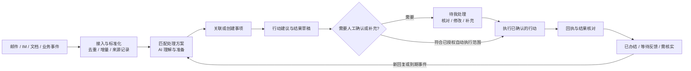

# 通用智能工作台需求梳理

状态：需求草案，待按产品优先级收敛；规划能力不代表已经实现。

日期：2026-10-14。现状依据：`bkms-workbench@0.1.1`，commit `78e64c175a38e67e21dcc2c232cd07e98460584c`，以及当前 README、架构说明和源码。

## 1. 产品定位与目标

定位为 DSH 内的通用智能工作台：接收不同系统的信息，按用户定义的处理方案理解和准备工作，将需要人决定的行动集中到待办，调用 DSH 已授权的能力执行，并持续跟踪结果。

用户主要关注四个问题：现在有什么需要我处理；AI 已经完成了什么准备；我需要决定或补充什么；执行后这件事是否办结。

邮件是首个接入渠道，客户订单是首个可复用的场景参考。通用结构不能固定成“客户订单处理系统”：销售询价、售后、会议跟进、采购、行政审批、合同审核都应能通过处理方案扩展。行业字段、业务模板和专用系统连接放在场景扩展中。

首阶段以当前单用户 DSH 实例为使用边界，支持多账号、多渠道。团队共享列为后续阶段，需要共享服务、身份和数据权限支撑；单机插件中的多个账号不等于多人协作。

## 2. 对五层参考架构的调整

保留信息接入、AI 理解、行动、协同与支撑五个职责。权限、来源记录、搜索、通知、连接管理应贯穿接入和执行全过程；统一收件箱是信息视图，不应在执行完成后才出现。

核心链路：

个人先形成完整闭环，再扩展团队分派与共享视图。AI 提供理解、建议和草稿；处理方案、权限和外部系统校验决定可执行范围。

## 3. 信息、事项、任务和行动

| 对象 | 含义 | 示例 |
| --- | --- | --- |
| 来源信息 | 外部系统的一条原始或更新信息，保留定位和版本 | 一封邮件、一条 IM、一份会议记录、订单状态事件 |
| 事项 | 持续跟踪的业务主题，可以关联多条信息与多个任务 | 某客户的本次询价、订单交付异常、一份合同审阅 |
| 任务 | 为推进事项需要完成的工作，带状态、负责人及可选截止时间 | 核对报价、确认交期、审核回复、安排沟通 |
| 行动 | 具体可执行的操作，独立记录输入、审核和回执 | 发邮件、发 IM、创建日程、提交申请、更新订单 |
| 处理方案 | 对什么信息，按什么步骤，使用什么能力，产生什么结果 | 询价回复方案、会议跟进方案、采购申请方案 |

不强制每条信息创建待办。纯通知可以形成摘要或归档；有明确工作要求的信息才生成任务；一个事项可以同时有待审核回复和等待库存核对两个任务。

支持人工新建事项和任务，补充文本、链接或文件、设置可选期限、手工标记完成；没有外部来源时也能使用工作台。人工录入与自动接入复用同一套处理、审核和跟进流程。

当前每封邮件一个任务的历史数据先保留。新结构需要有兼容迁移与备份方案，不能直接把历史“已发送”改写成业务“已办结”。

### 关联与去重

- 接入重复去重和业务关联分开：同一个来源事件重放不能重复入库；同一事项的新回复仍要保留。
- 邮件优先使用可靠的会话引用和来源标识，订单使用订单号，审批使用流程实例 ID；这些标识也要限定账号和系统范围。
- 仅靠名称相似、同一客户或 AI 判断不能直接把不同业务合并。语义关联给出建议及依据，由用户确认。
- 支持人工关联、拆分和撤销关联；没有可靠标识时先独立保存。
- 来源删除、日程变更和取消、业务状态更新属于更新事件，不能全部解释成新工作。

## 4. 信息接入需求

所有渠道通过共同接入约定进入工作台，保存来源系统、账号范围、来源标识、时间、参与人、正文或摘要、附件引用、原始定位、来源版本和同步状态。渠道专用字段作为扩展保留。

| 渠道 | 接入内容与期望处理 | 范围建议 |
| --- | --- | --- |
| 邮箱 | 新邮件、回复、附件；识别日历邀请内容及后续变更 | 先完善现有接入；邀请解析列为新增能力 |
| IM | 用户授权范围内的消息、提及、附件与回复线程 | 第二个渠道先选一个具备可用接口的平台 |
| 日历/日程 | 创建、调整、取消、参与人、时区、忙闲查询 | 随日程行动接入；不能假设所有账号可查询忙闲 |
| 会议 | 录音、转写、纪要、决议、行动项 | 先接入已有转写或人工上传；自动录音和转写单独选服务 |
| 文档/网盘 | 用户选择的文件、目录或文档更新，分析合同/方案/周报 | 先手动选择，之后按授权范围增量同步 |
| 订单/业务系统 | 订单变更、交付、采购、库存和异常事件 | 按场景接入一个明确的业务系统，采用可复用适配器 |
| 审批/流程 | 表单字段、审批状态、待审批节点 | 复用原系统模板和流程，不重建审批引擎 |
| CRM/客户 | 联系人、商机、沟通记录及关联字段 | 按已授权账号读取，更新记录作为独立行动审核 |

不把“微信”当成已经存在的统一接口。个人微信与企业微信的接入条件不同；具体 IM 平台要核实账号、API、消息范围和可执行能力。连接器以实际能力声明呈现，缺失功能不能用模拟成功代替。

接入方式允许增量轮询、Webhook 和人工导入。需具备断线续传、重放去重、同步失败可见、账号断连可恢复、来源定位可打开。邮件沿用增量游标，不以“未读”决定是否处理。新增来源默认从启用时建立基线；历史补处理作为用户明确选择的操作，先显示范围与数量。

## 5. AI 理解与结果准备

| 能力 | 输出要求 |
| --- | --- |
| 摘要与分类 | 用短文本说明发生了什么，区分信息通知和可行动请求 |
| 实体抽取 | 人、组织、时间、金额及币种、订单号等；保留原文出处，未知值留空 |
| 意图识别 | 需要回复、补资料、决策、排期、跟进或归档，可多选 |
| 优先级建议 | 结合明确截止时间、业务影响、已配置优先级；显示理由，允许人工调整 |
| 关联匹配 | 给出候选事项及依据，处理可靠标识与语义建议的区别 |
| 风险与校验 | 区分缺少依据、时间冲突、收件人限制和业务规则异常，提供依据 |

金额、日期、人物关系和业务结论应可核对出处。相对日期根据来源时间和时区解释；缺少时区、年份、金额单位等关键条件时应提示确认。模型自报的置信度不能替代业务校验，也不能直接作为允许外部执行的标准。

根据处理方案产出摘要、行动项、回复草稿、会议纪要、表单草稿或业务更新建议。输出明确“已知信息”“缺失信息”“建议行动”，缺少价格和交期依据时请求补充，不自行补全事实。

## 6. 行动与审核

| 行动类型 | AI 准备 | 人工或外部校验重点 |
| --- | --- | --- |
| 任务创建/拆解 | 可执行的任务及先后关系 | 标题、负责人、期限、是否重复 |
| 日程安排 | 候选时间、议题、参与人 | 时区、冲突、地点、是否向外部发邀请 |
| 会议纪要 | 决议、负责人、期限和待确认项 | 决议是否有来源，不能把建议写成已达成共识 |
| 邮件/IM 回复 | 正文、收件人或目标会话、附件 | 核对实际发送内容、账号与目标 |
| 审批发起 | 按原系统模板填单 | 必填字段、金额、附件、审批路线与提交对象 |
| 订单跟进 | 当前状态、异常说明、更新建议 | 来源版本、允许改动的字段和业务状态约束 |
| 自动工作流 | 在已保存方案内编排行动 | 每步授权、执行条件、失败后的处理方式 |

建议采用三种执行模式：

1. **自动准备**：完成授权范围内的读取、分析、摘要、草稿和工作台内部任务整理。作为默认模式。
2. **审核后执行**：确认具体动作后，执行发送、邀请、业务系统更新或流程提交。下一阶段优先完善此模式。
3. **限定自动执行**：后续对用户明确配置的动作、对象、字段及边界开放，不能靠一句笼统“自动处理”授予全部写权限。

审核需展示确切目标和改动内容，多个动作可分别批准或拒绝。正文、目标、附件、来源数据或方案变化后，相关旧审核失效，重新核对。已执行动作不能因为其他步骤失败而再次执行。

外部执行记录幂等标识、提交时间、回执和结果。可安全重试的读取/准备与可能已经成功的写操作分开处理；结果不明先进入“需核实”，通过状态查询或人工核对确认，避免重复发信、重复建日程和重复提交。

## 7. 处理方案：自然语言创建，结构化执行

通用界面名称建议由「邮件处理方案」逐步调整为「处理方案」；详情以来源类型区分，保留已有邮件方案与数据兼容。

用户用一句话创建候选，再核对以下信息：

| 项目 | 示例/要求 |
| --- | --- |
| 信息范围 | 哪个渠道、账号、文件夹、会话、项目或业务对象；从已连接系统选择 |
| 触发条件 | 新信息、回复、状态变更、定时、到期或人工触发 |
| 筛选条件 | 精确条件和语义条件分开；显示真正支持和执行的范围 |
| 处理步骤 | 提取需求 → 查询依据 → 核对缺失 → 生成行动结果 |
| 使用能力 | 当前已安装、已授权的 DSH 技能、工具或连接器 |
| 输出结果 | 回复草稿、任务、纪要、报告、日程建议等，可组合 |
| 执行模式 | 自动准备 / 审核后执行 / 限定自动执行 |
| 跟进与异常 | 期限、缺失信息、重试、升级人工、等待反馈的处理方式 |

基础页面只显示范围、处理要求、结果和执行方式，其他选项采用默认值与高级设置。账号、文件夹、会话、表单模板、业务状态等使用真实选项，不要求用户记住内部 ID。读取失败显示重试并保留选择。

AI 候选不自动保存、启用或执行业务。未支持的自然语言要求必须明确列出；不能在描述中写了“语义识别/金额筛选”，实际仍用空条件处理所有信息。测试应显示匹配范围、关联建议和将产生的行动，测试本身不向外部写入。

同一信息默认使用首个匹配的主方案，优先级可调；一条主方案可以准备多个行动。后续若支持多个方案并行，必须显式配置，并检测重复或冲突的外部动作。保存方案版本，运行使用快照，编辑方案不改变正在审核的既有结果。

## 8. 工作台界面与交互

DSH 侧栏保留一个「任务工作台」入口，内部组织不同视图，避免为每个来源新增独立侧栏菜单。无品牌横幅、角色形象或装饰性 Logo；界面跟随 DSH 中英文与主题设置，业务内容保留原语言。

### 主视图

| 视图 | 用户目的 |
| --- | --- |
| 待我处理 | 查看待审核、待补充、需决策和异常任务，优先呈现本人要做的下一步 |
| 事项 | 查看跨渠道上下文、执行中、等待反馈、已办结和全部历史 |
| 信息 | 查看原始接入与纯通知，不让所有消息变成待办 |
| 处理方案 | 一句话创建、核对、测试、启停和维护方案 |
| 运行记录 | 查看已实际执行的动作、回执、失败与恢复，不要求用户阅读内部模型推理 |

概览可嵌入主视图，优先呈现今日到期、逾期待办、执行异常和关键事项；不要用大面积统计卡片压缩实际待办区域。项目、客户和负责人先作为过滤与关联维度，规模增长后再提供独立视图。

列表显示事项标题、下一步、状态、优先级依据、期限、来源及最近活动。详情包含：发生了什么、相关原始信息、AI 的准备结果、需要决定/补充的内容、拟执行动作、历史与回执。正文和附件可独立查看，草稿支持标准排版预览及编辑。

提供「确认执行」「保存修改」「补充信息」「重新准备」「稍后处理」「忽略/归档」等与状态对应的操作。暂缓需要可选恢复时间；忽略保留原因和历史；批量处理只用于适合批量的内部整理，多个外发内容仍需逐项核对。

### 设置边界

DSH 设置只放入口显示/隐藏、待办提醒、来源同步偏好、默认显示偏好和连接配置入口。任务处理、方案编排、草稿审核留在工作台。隐藏入口与关闭提醒都不暂停处理；暂停处理使用明确的后台开关。

默认不弹原始新消息通知，待办提醒也可关闭。启用提醒后按事项合并，支持即时或摘要节奏、到期提醒和不同等级；提醒遵守用户所选范围，不能以“高优先级”为由绕过关闭设置。避免各来源与工作台重复提醒，同时保留原系统与对话内手动查询能力。

## 9. 状态与跟进闭环

事项状态建议：待准备、处理中、待我处理、等待反馈、已办结、已归档。任务和行动各自维护状态，事项展示综合结果和下一步。

行动状态建议：草稿、待确认、执行中、已成功、已失败、结果需核实、已取消。任务可因缺失材料进入待补充，而不是笼统失败。

“邮件已发送”代表发送行动获得相应回执，不等于订单处理完成；同样，申请已提交不等于审批通过，日程已创建不等于会议已完成。事项按方案的完成条件或用户确认办结。

等待反馈可配置下次跟进时间。到期后生成跟进建议或待办，默认不自动向外部催办；收到相关回复时更新同一事项。逾期与“需要人处理”分开计算，避免把所有等待状态都当成用户待办。

## 10. 协同与支撑能力

| 能力 | 基础需求 | 后续扩展 |
| --- | --- | --- |
| 项目/客户 | 关联、过滤、上下文汇总、人工纠错 | 项目看板、客户时间线、跨事项关系；OKR 在有明确使用需要时补充 |
| 团队协同 | 首阶段预留负责人/可见范围语义 | 分派、共享看板、评论、@、审核人、操作冲突与权限校验 |
| 全局搜索/问答 | 先按标题、来源、状态和日期查找 | 对已授权信息问答并引用来源；自然语言查询默认不执行写操作 |
| 通知中心 | 待办提醒开关、去重和异常可见 | 事项聚合、分级、摘要、安静时段、到期节奏 |
| 报表 | 待办、期限和异常状态统计 | 周报/月报草稿、效率趋势；口径区分行动成功、任务完成与事项办结 |
| 权限与审计 | 显式工具范围、审核版本、来源和执行回执 | 团队级身份、行级数据权限、脱敏、保存周期、导出和审计查询 |
| 集成管理 | 能力声明、账号范围、健康状态和同步恢复 | Webhook 接入、适配器目录、跨系统映射；复用既有认证机制 |

信息访问和外部执行的权限独立。邮件正文、附件和聊天内容作为资料读取，不能修改处理方案、授予新工具或代替用户批准。分析结果、查询和报表沿用来源可见范围，不能通过聚合或 AI 问答扩大可访问内容。

已有 JSON 存储适合当前规模；事项关系、检索与并发增加时再评估本地数据库，并设计迁移/备份。团队共享需要独立服务方案，不直接把单机文件共享给多人写入。

## 11. 插件与 DSH 的职责

`bkms-workbench` 继续作为独立插件，负责统一信息与事项、处理方案、待办、审核、行动编排、跟进和用户界面。工作台不重复保存各平台的密码，也不自行实现所有渠道 SDK。

邮件来源与动作由工作台内置邮件模块提供，IM/日历/文档/业务系统由连接器提供；DSH 提供模型、Agent、技能、工具、权限与基础客户端服务。通过共同适配约定连接，具体能力先核实，不能假设工具名称存在就一定支持后台、只读、幂等或结果查询。

客户订单等专用场景用方案模板、专用技能和业务连接器组合。通用核心不硬编码 ERP、订单字段、审批路线或某个客户的组织结构。

## 12. 当前能力与差距

| 范围 | 当前 0.1.1 实际能力 | 下一步差距 |
| --- | --- | --- |
| 接入 | 邮件增量、附件、游标去重与断线恢复 | 统一信息对象和第二种来源；邮件邀请/变更尚未实现 |
| 方案 | 多方案、优先级首匹配、自然语言候选、真实文件夹选择 | 通用来源、语义筛选、组合输出、触发类型和执行模式 |
| AI 准备 | 摘要、回复草稿、缺失信息、授权读取技能/工具 | 稳定的实体/证据、任务拆解、事项关联和更多行动产物 |
| 审核执行 | 草稿编辑、附件、发送预览、明确确认及结果需核实 | 通用行动审核、日程/IM/业务写入与分步回执 |
| 跟进 | 单封邮件任务、历史与重新生成 | 跨消息事项、等待反馈、期限、到期与完成条件 |
| UI/设置 | 任务列表、处理方案、日志、中英文、入口和提醒偏好 | 事项/信息视图、统一详情、跟进与提醒聚合 |
| 协同 | 单用户、本地实例 | 多人身份、分派、共享与权限；当前没有团队协作服务 |

现有测试主要用替身模型与邮箱，不能把它当作全部外部平台接入或生产场景的验证。

## 13. 建议分期

### 第一阶段：邮件闭环与通用基础

优先完成统一来源对象、事项/任务/行动分离、邮件线程可靠关联、统一结果和人工审核、期限与等待反馈、方案结构扩展。保留现有账号、方案、草稿和历史，不因重构丢数据。外发继续审核后执行。

验收重点：同一邮件线程的补充资料进入同一事项；草稿发出后能等待回复并按时跟进；用户只看到自己需要处理的下一步；方案和来源变化不会导致旧审核误执行。

### 第二阶段：跨渠道复用

接入一个确定具备可用接口的 IM 平台，支持手动导入文档或会议转写，加入日程建议及审核后创建。将同一套方案、详情和审核流程实际复用到第二种来源，验证通用性。

验收重点：邮件和 IM 可关联到同一事项，保持来源清晰；文档/会议结果形成任务；消息发送和日程创建有确切预览与回执。具体平台在账号和接口条件明确后选择。

### 第三阶段：业务与协同

先选一个订单/CRM/审批场景完成字段映射、校验、审核写入与结果查询，再扩展模板、团队分派、共享权限、项目/客户视图、搜索问答与报表。限定自动执行按已验证的动作逐项开放。

阶段顺序是范围建议，不承诺所有系统同时接入，也不在没有接口与组织要求时估算固定工期。

## 14. 核心验收场景

1. 重放相同来源事件，信息与行动不重复；同一事项的新回复可追加并继续处理。
2. 纯通知按方案归档或摘要，不生成无意义待办。
3. 补充邮件或人工资料更新上下文，已有手工草稿保留，新版本单独核对。
4. 实体缺失或关联有歧义时等待确认，不编造订单号、金额、负责人和期限。
5. 自然语言生成方案展示实际匹配范围与不支持项；未保存的候选不能启动处理。
6. 审核后修改目标、正文、附件或相关依据，旧确认不能执行新内容。
7. 外部操作超时且结果不明，进入需核实；不会盲目重发或重复提交。
8. 行动成功后事项仍可等待反馈；到期生成跟进待办，明确完成条件后才办结。
9. 账号失效或连接器下线，保留任务和产物；恢复后续传且不重复执行成功动作。
10. 隐藏入口或关闭提醒不暂停后台；重新开启提醒不批量补弹历史待办。
11. 中英文切换保留未保存编辑，界面统一翻译，原始消息与业务字段不自动改写。
12. 第二渠道复用同一套事项/审核/执行逻辑，差异集中在适配器和场景模板。

## 15. 产品方向待定项

以下项目暂按建议保留，不作为已经获得授权的实现或外部集成：

- 首批主要使用者：建议先个人使用，再考虑团队共享。
- 第二个来源：在飞书、钉钉、企业微信、Slack 等实际可用账号中选一个。
- 首个业务扩展：客户询价/订单、会议跟进、合同审核或内部审批中选一个高频场景。
- 自动执行范围：建议先自动准备、审核执行；哪些具体动作可免逐次确认需单独定义。
- 跟进时间与完成条件：确定常用默认值，允许每个方案和事项覆盖。

下一轮实现应先选定第一阶段的具体验收流程，再细化数据迁移、页面设计、连接器契约和开发任务。
